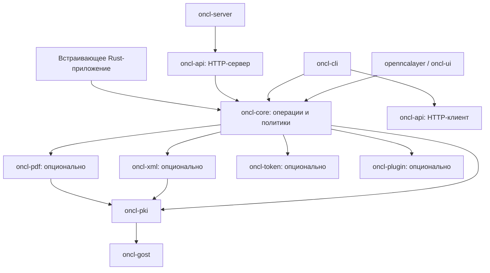

# OpenNCALayer как платформа: SDK, desktop, CLI и HTTP API

Связанные документы: [дизайн и состояние работ](roadmap.md), [плагины](plugins.md), [токены](tokens.md).

Документ описывает целевой дизайн платформы. Что из него уже сделано и проверено, написано в `docs/dev/platform-acceptance.md` и `docs/dev/platform-interop.md`.

## 1. Цель и основные решения

OpenNCALayer становится Rust-платформой для работы с казахстанской ЭЦП, которая не привязана к desktop. Desktop остаётся одним из её потребителей и не владеет криптографией. Desktop рассчитан на обычного человека; серверный режим нужен для программных интеграций.

Основные решения:

- Одна реализация, четыре способа ею пользоваться: встраиваемый Rust SDK; desktop с совместимостью NCALayer и ручными инструментами; самостоятельный CLI, который может работать и как HTTP-клиент; автономный HTTP-сервис.
- По криптографическим возможностям платформа полностью заменяет NCANode, но со своим контрактом: запросы и ответы NCANode не повторяются. Сверх этого есть хеширование, штампы времени, шифрование и разрешённые операции плагинов.
- Большие документы обрабатываются и структурно (XML, PDF), а не только как байты. Гарантированный размер документа 1 ГиБ (`1_073_741_824` байт); документ больше отклоняется ошибкой `InputLimit`. Контрольная операция укладывается в 1 ГиБ памяти на 64-битной конфигурации; временные файлы разрешены. Проверки границ u64 выше 1 ГиБ остаются проверками корректности арифметики и гарантией не являются.
- Desktop собран вокруг одного центра инструментов. Запросы сайтов показываются в отдельном компактном окне, подпись идёт по шагам, есть недавние файлы и избранное без секретов, разблокировка ключа между операциями не кешируется.
- Модели полномочий у desktop и сервиса разные и явные: в desktop пользователь подтверждает действие, в сервисе права выдаются заранее. У каждого клиента свой токен, права выдаются на операции, ключи и плагины. Новый HTTP API по умолчанию полностью выключен.
- Постоянной очереди заданий и архива документов нет. Ведётся локальный аудит метаданных; если обязательный аудит недоступен, закрытый ключ не применяется. OTLP-метрики и трассировки включаются по желанию и аудит не заменяют.
- Один workspace и общий номер версии у SDK и приложений. CLI и сервис собираются без GUI. SDK поставляется из git по тегу выпуска и в crates.io не публикуется (Р44 в [`publishers.md`](publishers.md#решения-владельца)); публикация браузерных расширений выполняется отдельно.

В эту работу не входят темы оформления, профили, корпоративный брендинг и управление организацией, универсальные формы настроек плагинов, шифрование по паролю и универсальная интеграция PKCS#11/HSM.

## 2. Исходная структура и сохранение контрактов

Проект и до этой работы был разделён на крейты, но модули были плохо пригодны для самостоятельного использования:

- `oncl-pki` содержал PKI, CMS, XMLDSig/XAdES, контейнеры ключей и сетевые проверки; `oncl-gost` содержит криптографические примитивы.
- `oncl-flows` не зависит от Slint, но описывает интерактивные сценарии страниц, выбор ключей, согласия на файлы и PIN и очередь диалогов процесса.
- `oncl-plugin` объединяет WASM-рантайм, capabilities, хранение и доставку пакетов и использует flows и update.
- `openncalayer` напрямую зависит от UI, интеграции с рабочим столом и обновлений. Его библиотека объединяла WSS/IPC, установку, настройки, плагины, CLI и проверку CMS.
- XML-парсер принимал не больше 64 МиБ и строил `roxmltree::Document`; интерфейс обработки получал весь XML в `&[u8]`. Поднять одну константу для больших документов было недостаточно.
- В пользовательских настройках уже были язык (ru, kk, en или системный), автозапуск, прокси, обновления и экспериментальное включение токенов. У плагинов уже были `settings_get` и `settings_put`.

Исходная структура видна в `Cargo.toml`, `crates/openncalayer/Cargo.toml`, `crates/openncalayer/src/lib.rs`, `crates/oncl-flows/src/lib.rs`, `crates/oncl-pki/src/lib.rs`, `crates/oncl-desktop/src/settings.rs` и в [контракте settings плагинов](plugins.md#settings).

`openncalayer` подключает `oncl-core/plugins` только для реестра ручного окна (`plugins/manual.rs`, по установленным пакетам `Store`); страницы и WSS по-прежнему идут через `PluginModules`.

Сайты продолжают работать через протокол NCALayer, WSS и native messaging, установленные модули и зафиксированные отличия портов. Новый HTTP API этот интерфейс не заменяет, его аутентификация на WSS не распространяется, а новые лимиты больших файлов не расширяют старые лимиты протокола.

У общего механизма проверок есть явная политика. SDK, CLI, HTTP и ручные инструменты desktop по умолчанию используют строгую политику. Адаптер NCALayer сохраняет документированную семантику совместимости, включая согласованные условия применения ключей; это отдельная политика, а не тихий откат из строгого режима. Отчёт не называет непроведённую проверку успешной. Внешнее поведение меняется только явным решением, а не случайной правкой общего значения по умолчанию.

## 3. Модули, интерфейсы и зависимости

### 3.1 Направление зависимостей

SDK и есть модуль операций; второго движка под тонким публичным слоем нет.

Имена крейтов описывают структуру репозитория и не означают, что такие имена свободны в crates.io. Это проверяется перед публикацией.

| Модуль | Ответственность |
|---|---|
| `oncl-core` | Публичный Rust SDK: типизированные операции, выбор формата, общие проверки и политики, источники ключей и данных, ресурсные бюджеты, структурированные результаты. Без UI, установщика, автозапуска и самообновления |
| `oncl-pki` | Контейнеры, сертификаты, CMS, PKIX, OCSP/CRL, TSP и общие механизмы PKI; применимые пути работают в ограниченной памяти. Решений desktop не содержит |
| `oncl-xml` | XMLDSig, XAdES, WS-Security, каноникализация и потоковая обработка больших XML. Код XML перенесён из `oncl-pki`, а не скопирован |
| `oncl-pdf` | PDF и PAdES: ByteRange, инкрементальные ревизии, встроенные подписи, их проверка и достройка. Отдельная тяжёлая зависимость, которая не нужна потребителю, работающему только с CMS |
| `oncl-gost` | Примитивы и нужные стандартные алгоритмы. Ничего не знает об HTTP, окнах и настройках пользователя |
| `oncl-token` | Драйверы носителей и операции, которые носитель умеет. Подпись, расшифрование и согласование ключа не считаются взаимозаменяемыми |
| `oncl-plugin`, `oncl-pdk` | Исполнение WASM по выбору и контракт host-capabilities. Рантайм получает явные адаптеры интерактивного или безоконного контекста, GUI не требует и от `oncl-core` не зависит |
| `oncl-flows` | Интерактивные сценарии desktop и правила согласия для страниц. Использует общие проверки, своей копии криптографии не содержит. Его очередь диалогов не выстраивает серверные операции в очередь |
| `oncl-api` | Версионированный HTTP-контракт, OpenAPI, преобразование ошибок и потоковые ответы; клиент и сервер включаются разными features. CLI-клиент не тянет за собой сборку сервера |
| `oncl-cli` | Разбор аргументов, локальный вызов SDK или HTTP-клиента, работа с файлами и stdio, вывод и коды выхода |
| `oncl-server` | Сборка HTTP-сервиса: конфигурация, аутентификация и права клиентов, провайдеры ключей, аудит, лимиты, телеметрия и жизненный цикл процесса |
| `openncalayer`, `oncl-ui`, `oncl-desktop` | Сборка desktop, Slint, трей, системная интеграция, обновления и интерфейс NCALayer; пользуются общим движком |

Отдельных крейтов на каждый метод и промежуточных слоёв, которые только передают вызовы дальше, нет; подходящие модули используются повторно. При переносе кода переводятся все внутренние потребители, документация и проверки, а старые модули и псевдонимы не оставляются.

### 3.2 Контракт SDK

SDK даёт типизированные семейства операций, а не одну функцию, принимающую JSON NCALayer. На входе явно задаются источник данных, место для результата, ключ или получатели, профиль операции, доверие и ограничения ресурсов. На выходе возвращается результат и структурированный отчёт или ошибка.

- Источники бывают последовательные (длина может быть заранее неизвестна) и с произвольным доступом. Если формату нужен промежуточный файл, он создаётся явно и не прячет полную буферизацию в памяти.
- Приложение-хозяин даёт транспорт PKI, секреты и провайдеры ключей, временное хранилище, отмену, прогресс и настройки доверия. Настройки desktop SDK не читает.
- Создание библиотеки не запускает демон, GUI, фоновое обновление, OTLP-экспорт, глобальный логгер или свой async-рантайм.
- Базовый потоковый контракт синхронный и подходит для обычного файлового ввода-вывода. HTTP-адаптер выносит блокирующую и вычислительную работу в ограниченный пул и не блокирует сетевой цикл событий. Детали асинхронности на криптографическую семантику не влияют.
- Чисто криптографические проверки работают без сети; полная проверка доверия отдельно учитывает данные, которые нужно получить из сети.
- Аппаратные токены, PDF, XML, плагины и OTLP не обязательны для минимального встраивания. Минимальная сборка проверяется отдельно от полной.
- Ошибки различают некорректный ввод, неподдерживаемый профиль или операцию, отсутствие прав, необходимость взаимодействия с пользователем, недоступный секрет или носитель, ограничения ресурсов, отмену, сеть и внутреннюю ошибку. Текст для человека машинным кодом ошибки не служит.
- При ошибке потоковый приёмник может содержать незаконченное начало результата. Успех определяется финальным результатом, а не наличием выходных байтов; файловые адаптеры публикуют конечный файл только после успешного завершения.

## 4. Криптографические возможности

### 4.1 Возможности NCANode

Эталоном полноты служит [OpenAPI NCANode закреплённой ревизии](https://github.com/ncanode-kz/NCANode/blob/0adab29a7d30c181d70e8cc6b4f243122f50c3b8/openapi.yml), а не текущая ветка `master`. Маршруты NCANode ниже обозначают сравниваемые возможности; наши URL и формат запросов от них не зависят.

| Семейство | Обязательные возможности |
|---|---|
| CMS / CAdES | Присоединённая и отсоединённая подпись; создание, несколько подписантов, добавление подписи, извлечение содержимого, проверка; уровни B, T, LT, LTA; достройка подписи до LT и LTA (`/cms/sign`, `/cms/sign/add`, `/cms/extract`, `/cms/verify`, `/cms/extend`) |
| XMLDSig / XAdES | Создание и проверка, несколько подписей, добавление и замена там, где это предусмотрено профилем; B, T, LT, LTA (`/xml/sign`, `/xml/verify`). Каноникализация и ссылки влияют на корректность подписи |
| WS-Security | Подпись и проверка SOAP/WSSE (`/wsse/sign`, `/wsse/verify`) с проверкой того, какой узел подписан и какой используется |
| PDF / PAdES | Встроенная подпись PDF и её проверка; B, T, LT, LTA, достройка (`/pdf/sign`, `/pdf/verify`, `/pdf/extend`). Внешняя CMS-подпись байтов PDF эту строку не закрывает |
| JWS | Создание, добавление подписанта и проверка (`/jws/sign`, `/jws/sign/add`, `/jws/verify`); сериализации и отсоединённые варианты описаны в матрице профилей |
| JWT | Создание, разбор и проверка в пределах контракта (`/jwt/encode`, `/jwt/decode`). Разбор не считается проверкой; подпись и проверки claims различаются; алгоритм не выбирается по недоверенному заголовку |
| X.509 / сырая подпись | Сведения о сертификатах, подпись и проверка произвольных данных отдельной подписью (`/x509/info`, `/x509/sign`, `/x509/verify`). Выпуска сертификатов своим CA это не означает |
| PKCS#12 | Сведения о контейнере и сертификатах, список псевдонимов (`/pkcs12/info`, `/pkcs12/aliases`). Права экспортировать закрытые ключи клиент не получает |

Для каждого семейства нужна матрица профилей, алгоритмов, положительных и отрицательных примеров и независимой проверки. Метод с названием `sign` или успешная проверка только нашим собственным верификатором полноты не доказывают. Ограничения безопасности и отличия описываются явно; если целого семейства нет, полной заменой это не называется.

### 4.2 Дополнительные возможности

- Отдельное вычисление хешей, получение и проверка штампов времени RFC 3161, просмотр и проверка сертификата, цепочки и статуса отзыва.
- Шифрование для одного или нескольких получателей по сертификатам и расшифрование соответствующим закрытым ключом. Стандартные профили CMS; обязательны RSA и применимые казахстанские профили ГОСТ.
- Контролируемый программный вызов поддерживаемых операций плагинов.
- Пакетная обработка в SDK, desktop, CLI и API с отдельным результатом для каждого элемента.

Криптография ориентирована на казахстанскую ЭЦП: ГОСТ 2004, ГОСТ 2015/512 и RSA, а также явно настроенные CA с поддерживаемыми алгоритмами. Все международные алгоритмы не обещаются. Проверка старых подписей RSA-SHA1 сохраняется, но создавать новые подписи RSA-SHA1 нельзя.

Алгоритм, назначение сертификата и возможности ключа или носителя проверяются для конкретной операции. Сертификат для подписи не становится пригодным для шифрования оттого, что у него тот же владелец. Неподдерживаемый профиль не подменяется другим.

Для шифрования по ГОСТ нужна доказанная комбинация OID, параметров, согласования или транспорта ключа, wrap и шифрования содержимого. [RFC 4490](https://www.rfc-editor.org/rfc/rfc4490) описывает старые соглашения ГОСТ для CMS, [RFC 7836](https://www.rfc-editor.org/rfc/rfc7836) описывает сопутствующие алгоритмы, включая VKO, KDF и wrap. Совместимость с конкретным казахстанским профилем и кодировкой они не доказывают. Профиль выбирается только по независимым векторам; придумывать свой контейнер или подставлять российские OID нельзя. Как обстоит дело с этим профилем сейчас, описано в `docs/dev/platform-interop.md`, раздел «Профиля ГОСТ-шифрования нет: что доказано».

Модель целостности шифроконтейнера показывается как есть. Успешное расшифрование не подтверждает автора. В аутентифицированных профилях результат не выдаётся до проверки аутентичности; старые профили без аутентификации аутентифицированными не называются.

Генерация, экспорт и импорт закрытых ключей и управление их жизненным циклом в CLI и API не добавляются. Функции NCALayer для CSR и импорта остаются там, где были.

### 4.3 Проверка и доверие

Полная проверка даёт одно из трёх состояний: `VALID`, `INVALID`, `INDETERMINATE`. Отчёт содержит отдельные результаты по целостности, сертификату и цепочке, сроку, отзыву, меткам времени, применённой политике и основанию для времени проверки; при нескольких подписантах для каждого.

Если сети или свежих сведений об отзыве нет, успехом это не считается. Явная офлайн-проверка доступна: она перечисляет непроведённые проверки и смысл `VALID` не меняет. Если внутри подписи достаточно проверенных данных, офлайн-вывод строится на них. Обязательная проверка перед подписью не пропускается из-за временной недоступности сети.

Недоверенный `signingTime` не доказывает время подписи. LT и LTA проверяются с учётом доказательств времени и допустимости алгоритмов, а не только по текущему сроку конечного сертификата.

Сертификат или цепочка, присланные клиентом, могут помочь построить путь, но доверенным якорем не становятся. Дополнительные CA задаёт оператор или встраивающее приложение; HTTP-клиент расширить доверие запросом не может. Небезопасные конструкции XML, внешние сущности и неоднозначные ссылки ради совместимости не разрешаются.

## 5. Большие документы и ресурсы

Контрольный профиль: входной файл до 1 ГиБ, включая содержательные XML и PDF, и не больше 1 ГиБ памяти на одну операцию в отдельном 64-битном процессе. Измеряется фактическая память процесса, а не размер одного буфера. Отчёт фиксирует ОС, сборку, режим, файл, профиль, пик памяти, временный диск и длительность. Гарантии пропускной способности нет.

Предел 1 ГиБ относится к исходному документу. Результат может быть больше из-за упаковки и подписи и тоже учитывается квотой. Лимиты исходных данных, криптоконтейнера и транспортной обвязки разные: проверяющий и расшифровывающий код принимает законный результат обработки документа в 1 ГиБ, даже если служебные байты выводят его за 1 ГиБ. Эти надбавки ограничены своими бюджетами. Контрольный профиль не доказывает отсутствия ограничений на других платформах и не обещает поддержку любого враждебного документа такого размера.

Как это устроено:

- SDK принимает потоки и файлы, CLI работает с файлами и stdin/stdout, HTTP принимает двоичные потоки и multipart. Большой документ не нужно передавать одной строкой Base64 или внутри JSON.
- Потоковые пути CMS, хеширования и шифрования не держат весь документ в памяти. Форматам DER и профилям, которым нужна известная длина или повторный проход, разрешён промежуточный файл; формат при этом не подменяется.
- XML разбирается и канонизируется потоково там, где это возможно; для ссылок и поддерживаемых трансформаций используются файловые индексы и повторные проходы. DOM всего документа и кеш полной канонической формы не используются. Поддерживаются не только искусственные XML с одним огромным текстовым узлом.
- PDF читается с произвольным доступом к xref, объектам, ByteRange и инкрементальным ревизиям; весь PDF через полную модель в памяти не переписывается. Приёмка включает object streams, ревизии, существующие подписи и большое число объектов и страниц, а не только файл, добитый до нужной длины.
- Ограничения глубины, сложности трансформаций, ссылок, распаковки объектов, метаданных и объёма вычислений сохраняются. Они должны принимать контрольные содержательные документы, а не оставлять старый малый предел узлов при выросшем пределе байтов.
- Размеры и смещения считаются в проверенной 64-битной арифметике, преобразования к `usize` проверяются. Отображение всего файла в память не считается соблюдением лимита памяти без измерения.
- Лимиты входа, выхода, временного диска, памяти, длительности и числа одновременных операций задаются явно. Они действуют и без `Content-Length`: поток обрывается на лимите, а не после полного чтения.
- Общий бюджет сервера ограничивает параллельность. При нехватке ресурсов запрос получает явный отказ или ограниченное ожидание, а не копится без предела. Окна desktop сервер не блокируют. Команды одного токена могут выполняться строго по очереди.
- Прогресс различает известную и неизвестную общую длину. Отмена проверяется между безопасными шагами; уже применённый ключ отменённым не называется.

Временные документы разрешены только в выделенном хранилище, доступном одному владельцу, с квотами и ограниченным сроком жизни. Очистка удаляет только свои файлы и не обходит чужие каталоги; после сбоя убираются только опознанные остатки этого хранилища. Контейнеры ключей и пароли из запросов туда не пишутся. Права доступа не равны шифрованию диска, а физическое стирание на SSD не гарантируется.

Файловый результат сначала пишется во временный файл и публикуется после успеха; исходник неявно не перезаписывается. Для большого HTTP-ответа и stdio контракт явно описывает финальный статус и незаконченный результат, и клиент не сохраняет частичный файл как успешный. Криптографическая подпись транзакцией не является, откатить её нельзя.

Эти требования относятся к новому SDK и встроенным инструментам. Старые плагины сохраняют свои лимиты, включая строковые и Base64-интерфейсы, и при превышении возвращают конкретную ошибку. HTTP-обёртка не делает их потоковыми.

## 6. Desktop и пользовательские настройки

### 6.1 Внешний вид и взаимодействие

Принята структура с единым центром и предметный макет трёх экранов: ручная подпись, подтверждение запроса сайта и отчёт с недостаточными данными. Макет задаёт направление визуальной системы, а не готовый UI и не окончательные тексты.

- Центр с боковой навигацией: обзор, подпись, проверка, шифрование и расшифрование, сертификаты, дополнительные инструменты (хеши, TSP, разрешённые плагины), управление плагинами, настройки.
- Центр открывается по запросу. Для работы с сайтами главное окно не нужно и при каждом запросе не открывается.
- Запрос сайта показывается в отдельном компактном окне с постоянно видимым доверенным контекстом. Сайт-инициатор, операция и существенные сведения не скрываются оформлением.
- Одна операция идёт в одном окне по шагам: источник ключа, разблокировка, сертификат и подтверждение, результат. Можно вернуться назад, не выбирая файл заново; чувствительные значения после операции не сохраняются.
- В ручном сценарии сначала выбираются файлы и формат, потом ключ. До выполнения видны состав пакета, профиль, место для результата и что произойдёт с исходными файлами.
- Разблокировка ключа не означает согласия подписать. Итоговая кнопка называет действие: подписать, войти или передать сведения, а не общее «ОК».
- Пакет подтверждается поэлементно. Если после подтверждения состав или содержимое меняются, нужно новое подтверждение. При необходимости программа делает свою копию входа и связывает выбранные байты с реально обработанными.
- До действия доступны полные сведения о сертификате: владелец, назначение, организация, срок и результат проверок. Имена файлов, присланные сайтом, помечаются как недоверенные.
- Отчёт проверки отделяет общий вывод от причин по проверкам и подписантам. Предупреждение о нехватке данных визуально отличается и от успеха, и от доказанной недействительности.
- Ошибка показывается рядом с полем или шагом, где она возникла; загрузка и отмена имеют явное состояние. Неподходящий сертификат не пропадает из списка молча: видна причина.

Остаётся Slint с текущими способами отрисовки; HTML использовался только для согласования макета. Системный шрифт, читаемый базовый размер, последовательные отступы и иерархия, одна основная кнопка, смысловые цвета. Переписывания на WebView или Electron, декоративных эффектов и загрузчика тем нет.

### 6.2 Что запоминается и настраивается

Сохраняются язык, автозапуск, прокси, обновления и экспериментальное включение токенов. Добавляются масштаб интерфейса и текста, полное управление с клавиатуры, видимый фокус и правильная работа при разных DPI. Управление не зависит только от мыши, цвета, перетаскивания или наведения.

Недавние пути и избранные сертификаты хранятся без закрытых ключей и паролей и очищаются по желанию. При использовании путь и сертификат проверяются заново: запись не доказывает, что файл не изменился. Это не профили человека или организации.

Пароли и разблокированные программные ключи между отдельными операциями desktop не кешируются и на диск не пишутся. Один явно подтверждённый пакет считается одной операцией и не разрешает подписывать следующие запросы сайта.

Новые настраиваемые категории трея и уведомлений, пользовательские и глобальные горячие клавиши и напоминания об истечении сертификатов не добавляются; существующее поведение остаётся. Постоянный журнал действий desktop по умолчанию выключен; технические логи архивом документов не становятся.

## 7. CLI и HTTP API

### 7.1 CLI

CLI работает без desktop и без сервера. Обращение к заданному HTTP-адресу включается явно и не требуется ни для какой операции.

Пакет `oncl-cli`, команда `oncl`; группы команд соответствуют возможностям SDK. Проверка CMS выполняется командой `oncl verify`; отдельной команды проверки у `openncalayer` нет. Команды desktop для запуска, установки и TLS в SDK не переносятся.

- Вход берётся из локальных файлов и stdin, результат пишется в явно указанный файл или stdout. В удалённом режиме путь входа означает путь на компьютере клиента: клиент передаёт байты, а не просит сервер открыть файл.
- Есть вывод для человека и машинный JSON с кодами и структурированным отчётом. Прогресс и диагностика в машинный stdout не попадают; двоичный stdout и JSON-отчёт не смешиваются.
- Секрет вводится интерактивно без эха; для автоматизации есть защищённый файл, дескриптор или явный внешний источник. Пароль или токен не передаётся обычным аргументом командной строки и не попадает в сообщения об ошибках.
- У пакета есть результат по каждому элементу и общий итог; успешные элементы не откатываются. По умолчанию после ошибки одного элемента независимые элементы продолжают обрабатываться, но отмена или потеря обязательных ресурсов останавливает работу.
- Неверная подпись, неопределённая проверка, ошибка выполнения, частичный результат и отмена различаются машинно. Таблица кодов выхода входит в версионируемый контракт CLI и не повторяет внутренние коды демона.

### 7.2 HTTP

Свой документированный контракт OpenAPI: HTTP/JSON для небольших управляющих сообщений, двоичные и multipart-потоки для больших данных. Маршрутов, совместимых с NCANode, нет.

Версия контракта задаётся префиксом `/v1`. JSON описывается типизированными структурами, у ошибок единая форма со стабильным `code` и идентификатором операции. HTTP-коды описывают транспорт, доступ и выполнение; завершённый отчёт с `INVALID` не превращается во внутреннюю ошибку. Большие документы не нужно кодировать в Base64.

- API по умолчанию полностью выключен: ни установка, ни запуск desktop, ни создание SDK не открывают порт, даже на loopback. Сервис включает оператор.
- После включения сервис по умолчанию слушает loopback. Внутренняя сеть разрешается явно. Работа напрямую в публичном интернете стандартным сценарием не считается.
- Каждый клиент получает свой отзываемый API-токен с правами на операции, идентификаторы ключей и операции плагинов. Общего пароля и анонимной подписи нет. mTLS обязательным механизмом не является.
- Для доступа по сети нужен защищённый транспорт: TLS в самом сервисе или явно настроенный доверенный обратный прокси. Произвольным `Forwarded` и `X-Forwarded-*` сервис не доверяет, а loopback аутентификацией не считает.
- Обычный запрос подписи не даёт клиенту доступа к путям на сервере, скачиванию документов по URL, управлению доверием к CA, чтению ключей и административным действиям. Исходящие запросы плагинов и PKI остаются отдельными ограниченными capabilities.
- Права проверяются до применения ключа и до вызова плагина. Выполняемая операция не может отличаться от разрешённой из-за другого метода или модуля во вложенных данных.
- Запрос выполняется в рамках соединения. Нет идентификатора задания для последующего опроса, планировщика, базы заданий, восстановления после перезапуска и гарантии ровно одного выполнения.
- Прогресс и большие пакетные результаты передаются потоковыми частями multipart: управляющие JSON-события, выходные данные и явный итоговый результат элемента или вызова. Если итога нет, исход неизвестен, и успехом это не считается. HTTP-заголовок сам по себе успеха криптографической операции не подтверждает.
- Обрыв соединения отменяет дальнейшую работу и удаляет временные данные запроса. Уже созданная подпись или выполненная команда токена задним числом не отменяется. Автоматического повтора операции, которая могла выполниться, нет.

## 8. Ключи, плагины без окон и секреты

### 8.1 Разделение полномочий

В desktop пользователь подтверждает конкретное действие. В сервисе полномочия заранее выдаёт оператор; окна не открываются, и ответ «Да» за пользователя не подставляется. Запуск локальной команды CLI выражает намерение оператора в пределах переданных параметров; подтверждение в GUI для CI не требуется.

Сервис не наследует ключи, согласия, недавние файлы, настройки и каталоги desktop. Приложение, встраивающее SDK, само отвечает за ключи и права, которые передаёт библиотеке; от привилегированного кода самого приложения библиотека не защищает.

### 8.2 Источники ключей

- Файлы PKCS#12 и JKS и поддерживаемые аппаратные токены. Запись и экспорт для JKS не добавляются.
- Основной сценарий сервиса: оператор подключает ключ, а клиент обращается к нему по разрешённому непрозрачному идентификатору.
- Только при явной настройке контейнер ключа и секрет можно передать в запросе. У секретных полей свои малые лимиты; большой поток документа не позволяет загрузить контейнер ключей без ограничений.
- Секреты подключённых ключей приходят извне: файлы, доступные только владельцу, смонтированные секреты или защищённый канал при запуске. В обычном конфиге хранятся ссылки, а не пароли. Своего менеджера секретов и интеграции с системными хранилищами секретов нет.
- Разблокированный ключ может храниться в памяти запущенного сервиса. После перезапуска секрет подаётся заново. API-токен не позволяет получить контейнер или секрет обратно.
- Ключи из аппаратного носителя не экспортируются. Расшифрование носителем, который умеет только подписывать, не обещается. Возможности проверяются явно, неподдерживаемая операция отклоняется.
- Драйверы токенов экспериментальные и на настоящих устройствах не проверены; об этом сообщается прямо. Проверка на эмуляторе за проверку на устройстве не выдаётся.

### 8.3 Плагины

Установленный плагин сам по себе через HTTP и CLI недоступен. Разрешаются конкретные плагины и операции; ключи, файловые и сетевые capabilities ограничиваются контекстом вызова.

Вызов из desktop и вызов из сервиса различаются. Клиент сервиса не выдаётся за доверенный сайт, а Origin из произвольного поля запроса доказательством происхождения не считается. Для операции, которая может работать без окон, нужные ключи и данные задаются явно. Если без взаимодействия с пользователем не обойтись, возвращается `interaction_required`, а не выдуманный ответ пользователя. Операции, которым нужна сессия браузера, работающими без окон не объявляются.

`settings_get` и `settings_put`, проверки capabilities и ограничения пакетов сохраняются. Конструктора настроек и экранов плагинов и произвольного UI-кода нет. Рантайм плагинов не тянет в минимальный SDK desktop, загрузчик каталогов и автообновление, пока соответствующая функция не выбрана явно.

## 9. Данные, аудит и наблюдаемость

### 9.1 Хранение и аудит

Постоянного архива документов, содержимого запросов, контейнеров ключей, паролей и результатов нет. Результат возвращается клиенту или сохраняется туда, куда указано. Временные данные подчиняются правилам раздела 5.

Сервис ведёт локальный аудит метаданных с настраиваемыми ротацией, сроком хранения и квотой: кто вызвал, какая операция, идентификатор ключа, время и итог. Содержимое и имена документов, секреты и необработанные тела запросов и ответов в аудит не пишутся. Связь сертификата с человеком в телеметрию не передаётся.

Перед применением закрытого ключа сервис должен записать обязательную запись аудита. Если аудит недоступен, подпись, расшифрование и другие применения закрытого ключа не выполняются. OTLP записью аудита не считается.

Записываются начало и итог операции с одним идентификатором, для пакета также каждый элемент. Если аудит отказал уже после применения ключа, сервис не делает вид, что действия не было: клиенту возвращается неопределённый или ошибочный исход, а новые применения ключей блокируются, пока аудит не восстановится. Потерянный ответ не означает, что ключ не применялся. Доказуемо неизменяемый журнал и неотказуемость не обещаются.

### 9.2 OTLP

OTLP-метрики и трассировки сервера включаются по желанию и по умолчанию выключены. Коллектор и параметры экспорта задаёт оператор. OTLP-логов нет; локальные технические логи и аудит работают отдельно.

Допустимые атрибуты: семейство операции и формата, класс результата, длительности, размеры, классы сетевых сбоев PKI, загрузка и потребление ресурсов. Документы, пароли, API-токены, ключевой материал, ИИН и БИН, полные пути, необработанные заголовки и тела, исходные тексты ошибок не передаются. Метрики не размечаются идентификаторами запросов, ключей и клиентов; трассировка не служит обходом запрета на персональные данные.

Трассировки можно семплировать, на полноту обязательного аудита это не влияет. Недоступный коллектор операции не блокирует: буферы экспорта ограничены, сбой доставки виден и память не расходует без предела. SDK не устанавливает глобальный подписчик или экспортёр, это решает приложение. Desktop из-за появления серверной функции телеметрию отправлять не начинает.

## 10. Поставка и совместимость

- Один репозиторий и workspace, общая версия SDK и приложений. Плагины живут по своим версиям.
- Desktop остаётся самостоятельным дистрибутивом со своей интеграцией. CLI и сервер собираются отдельно и ставятся без GUI и оконной системы.
- Сервер работает как самостоятельный процесс, служба или контейнер. Контейнер получает конфигурацию, секреты и временный каталог явно, не включает автозапуск desktop и не монтирует домашний каталог пользователя целиком. Обновлением серверной поставки управляет оператор; самообновление desktop туда не переносится.
- Поддерживаемые платформы desktop, включая Win7 x86/x64, остаются. Контроль 1 ГиБ документа и 1 ГиБ памяти проводится на 64-битной конфигурации; проверка импортов и старых ОС для сборок desktop остаётся обязательной. Новые зависимости не должны молча убирать старую целевую платформу.
- У Rust SDK документированный интерфейс, примеры встраивания, описанные ошибки, политика безопасности и правила semver. До версии 1.0 несовместимые изменения требуют соответствующей версии и указаний по миграции; не все внутренние модули считаются стабильным публичным контрактом.
- SDK и нужная цепочка пакетов готовятся к публикации: лицензии, содержимое пакетов, воспроизводимая сборка. Пока публикации нет, примеры подключают SDK через git или path и не предлагают ставить невыпущенную версию из реестра.
- Загрузка в crates.io и публикация браузерных расширений выполняются только по отдельной команде владельца. Публикация плагинов идёт своим порядком.
- Это не ребрендинг продукта, не разделение на отдельные репозитории и не повод переписывать механизм обновлений.

### 10.1 Установка desktop через WinGet

Основной пакет WinGet содержит только stable-версии desktop. Первый PR в `microsoft/winget-pkgs` отправляется отдельно, после проверок. Подписанное самообновление OpenNCALayer продолжает работать по настройке пользователя; WinGet даёт ещё один способ явно обновить установленную копию.

`PackageIdentifier`: `arynyklas.OpenNCALayer`; перед подачей проверяются его уникальность и соответствие издателя и записи ARP. Используются опубликованные HTTPS-ассеты конкретной версии для Windows x64 и x86, их SHA-256 и установка для текущего пользователя. WinGet требует Windows 10 1809 или новее, поэтому для Win7 остаются обычные установщики. Отдельных пакетов WinGet для SDK, CLI и сервера и канала Preview нет.

Нужен многофайловый манифест и проверка установки, обновления, переустановки и удаления в чистой Windows VM или Sandbox. Имя, издатель, DisplayVersion и данные для удаления берутся из фактической регистрации установленного приложения; одного имени тега для правильного обновления недостаточно. Самообновившаяся копия должна распознаваться без цикла понижения и повышения версии. Для самообновляющегося пакета используется поддерживаемое WinGet явное обновление, а наш апдейтер не отключается.

В закреплённой версии Velopack Setup поддерживает `--silent`, но при переустановке принудительно останавливает пакет. Поэтому установка и обновление через WinGet сначала берут у приложения локальную блокировку обслуживания: дожидаются завершения активных операций, не дают начать новые на время замены и возвращают явную ошибку, если безопасно дождаться нельзя. Однократной проверки, что программа простаивает, без удержания блокировки недостаточно. Принудительно прерывать активную подпись или передавать несуществующий ключ `--nolaunch` нельзя. Установщик-адаптер входит в поставку; GUI, доверие к CA и согласия на криптооперации он не подтверждает автоматически.

Пока Microsoft не примет манифест и пакет не появится в публичном источнике, команда `winget install --id arynyklas.OpenNCALayer --exact` остаётся целевым сценарием, а не работающей функцией. Локальная проверка YAML и `install --manifest` доступность в каталоге не доказывают. Для этого шага нужны опубликованная stable-версия и её приём в каталог; alpha-версии за stable не выдаются.

Источники: [манифесты](https://learn.microsoft.com/en-us/windows/package-manager/package/manifest), [процедура подачи](https://learn.microsoft.com/en-us/windows/package-manager/package/repository), [поддерживаемые Windows](https://learn.microsoft.com/en-us/windows/package-manager/winget/), [Setup закреплённой версии Velopack](https://github.com/velopack/velopack/blob/8d2844f324a69bd848719ef465b1ae12c5060524/src/bins/src/setup.rs), [путь установки](https://github.com/velopack/velopack/blob/8d2844f324a69bd848719ef465b1ae12c5060524/src/bins/src/commands/install.rs).

## 11. Приёмка

Таблица перечисляет, чем подтверждается готовность каждой области. Результаты прогонов записаны в `docs/dev/platform-acceptance.md` и `docs/dev/platform-interop.md`.

| Область | Чем подтверждается |
|---|---|
| Встраивание | Отдельное Rust-приложение собирается и подписывает и проверяет через SDK без демона, UI, графической сессии и серверного порта; в минимальном наборе зависимостей нет Slint, desktop и апдейтера |
| Отдельные приложения | CLI выполняет локальную операцию без фонового процесса; тот же сценарий через запущенный HTTP-сервис даёт ту же криптографическую семантику и отчёт; сервер работает без GUI |
| Полнота функций | Все строки раздела 4.1 сопоставлены с закреплённым эталоном и подтверждены содержательными положительными и отрицательными случаями. Подпись и проверка сверены с независимыми реализациями и стандартными векторами, а не только друг с другом |
| Новые операции | Отдельно проверены хеши, TSP, профили шифрования CMS для RSA и применимые казахстанские профили ГОСТ, несколько получателей, неверный ключ или назначение, повреждения и ограничения носителя |
| Большие данные | Через SDK, CLI и HTTP выполняются заявленные операции над содержательными файлами до 1 ГиБ, включая XML и PDF. Проверены границы (1 ГиБ принимается, 1 ГиБ + 1 байт отклоняется), вход неизвестной длины, вход и выход сверх лимита, память и временный диск. Одного разреженного или добитого файла для вывода о готовности недостаточно |
| Память и параллельность | В фиксированном 64-битном профиле одна операция укладывается в 1 ГиБ памяти; параллельные запросы ограничены общим бюджетом; отмена, квота и переполнение диска не приводят к нехватке памяти, испорченному успешному результату или забытым временным файлам |
| Проверка доверия | Различаются `VALID`, `INVALID` и `INDETERMINATE`, офлайн-режим и отсутствие сведений об отзыве, повреждённая подпись, неверная цепочка или CA, сроки и доказательства времени; цепочка от клиента доверие не расширяет |
| Авторизация | По умолчанию порт закрыт; включённый API требует токен и права. Проверены отозванный токен, чужой ключ, операция или плагин, подмена вложенного метода, недоверенные заголовки прокси и Origin, отсутствие доступа к путям на сервере |
| Секреты и аудит | Реальный вызов не оставляет секретов в конфиге, логах, аудите и временном хранилище; документы попадают только в ограниченное временное хранилище, но не в журналы и не в архив. Недоступный обязательный аудит не даёт применить ключ; сбой после применения не превращается в ложное «не выполнено» |
| Плагины без окон | Разрешённая совместимая операция работает без окна; обязательное взаимодействие даёт явную ошибку, а не автоматический ответ; старый лимит соблюдается; установленный, но не разрешённый плагин через API не вызывается |
| Desktop | На настоящем интерфейсе Slint пройдены ручная операция, запрос сайта, шаг назад и отмена, неверный пароль или PIN, неподходящий сертификат, пакет, сетевые ошибки и итог проверки; интерфейс соответствует принятой структуре и визуальной системе, работает с клавиатуры и при разных DPI. Макет в браузере этого не доказывает |
| Совместимость с NCALayer | Существующие сверка с оригиналом и smoke-тесты сохраняются; намеренные изменения контрактов и CLI перенесены целиком. HTTP API не меняет границы WSS и согласий страниц |
| OTLP | Тестовый коллектор получает разрешённые метрики и spans от реального вызова; проверено отсутствие запрещённых данных, выключенное состояние по умолчанию и ограниченные ресурсы при недоступном коллекторе |
| Поставка | Проверены наборы зависимостей отдельных пакетов, примеры SDK, упаковка и существующие проверки платформ; внешние публикации без отдельной команды не выполнялись |
| WinGet | Манифест stable проходит проверку; установка, обновление, переустановка и удаление x64 и x86 для текущего пользователя работают, не прерывают активную подпись при обновлении, не подтверждают доверие к CA и не теряют данные пользователя. Апдейтер и определение установленной версии согласованы. Установка из публичного источника проверяется после подачи и приёма манифеста; до этого шаг считается ожидающим |

Тесты закрепляют наблюдаемое поведение, границы, переходы, семантику ошибок и отсутствие утечек, а не текст исходников, случайные формулировки или передачу аргументов в mock. Большие сценарии можно гонять на отдельном воспроизводимом стенде, но они обязательны для приёмки.

## 12. Свобода реализации и неизменяемый объём

Разработчик сам выбирает библиотеки разбора, криптографии и HTTP, внутренние структуры, точные сигнатуры SDK, способы файлового индексирования и лимиты сложности, опираясь на измерения и стандарты, пока сохраняются согласованные возможности, безопасность, ресурсы и платформы.

Изменить предел 1 ГиБ документа и 1 ГиБ памяти, исключить XML, PDF или шифрование ГОСТ, заменить PAdES внешней CMS-подписью, отказаться от SDK или сократить покрытие возможностей NCANode можно только изменением этого дизайна. Техническая сложность не даёт права объявить готовым более узкий продукт.

Отложены только внешние публикации. SDK, архитектура без привязки к desktop, инструменты, форматы, большие документы, новый UI, аудит и наблюдаемость входят в объём работы.
