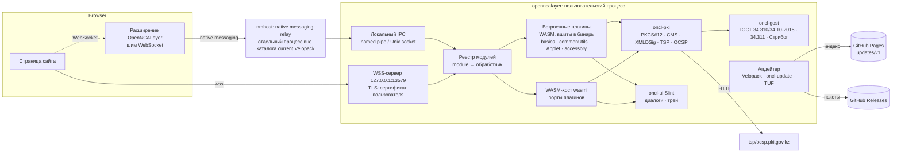
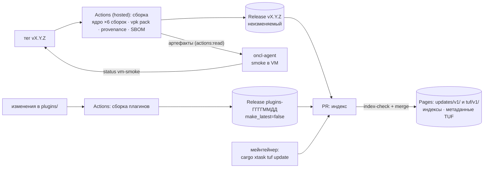

# OpenNCALayer: дизайн и состояние работ

Архитектура оригинального NCALayer описана в `docs/original/architecture.md`. Локальные заметки по реверс-инжинирингу оригинала не публикуются; в документы и код из них попадают только факты: OID, константы, форматы.

## 1. Цель

OpenNCALayer: открытая замена NCALayer на Rust. Сайты (egov.kz, госзакупки, банки, ЭДО), которые работают с оригиналом через `wss://127.0.0.1:13579`, должны работать с ним без изменений: в том же протоколе, с теми же модулями и с портами сторонних плагинов.

Развитие проекта в сторону SDK, CLI и HTTP-сервиса описано в [`platform.md`](platform.md).

## 2. Основные решения

| Тема | Решение |
|---|---|
| Язык | Rust, без Java |
| Имя | Продукт OpenNCALayer. Бинарь `openncalayer` (`openncalayer.exe`, никогда не `NCALayer.exe`). Префикс крейтов `oncl-`. Репозиторий `arynyklas/OpenNCALayer` |
| Лицензия | Apache-2.0 на весь репозиторий. Slint используется по лицензии Royalty-free 2.0 с атрибуцией `AboutSlint` |
| Транспорт | `wss://127.0.0.1:13579` с TLS-сертификатом пользователя. Сертификат можно получить тремя способами. 1. Мастер создаёт локальный CA с name constraints (127.0.0.1, ::1, localhost) и leaf сроком не больше 800 дней, после чего ключ CA уничтожается. Перевыпуск означает новый CA и повторную установку (кнопкой или вручную). 2. Leaf от CA, который у пользователя уже установлен: mkcert CAROOT или свой cert+key. С согласия пользователя OpenNCALayer читает ключ этого CA, выпускает leaf и перевыпускает его до истечения; сам ключ CA не копируется. 3. Готовый leaf с цепочкой. Проверка доверия только читает хранилища. Plain `ws://` не поддерживается |
| Установка сертификатов | OpenNCALayer сам сертификаты не ставит. Исключение: явная кнопка с подтверждением «Установить мой CA» или «Скачать и установить корни НУЦ» (с проверкой зашитых SHA-256). Сертификат ставится в хранилище текущего пользователя: Windows `CurrentUser\Root`, macOS login keychain, Linux NSS-базы выбранных профилей. Рядом есть кнопка «Удалить». Ни установщик, ни автозапуск ничего не ставят |
| Расширение браузера | Chromium MV3 и Firefox MV2. Расширение подменяет `WebSocket` к 127.0.0.1:13579–13679 и ходит через native messaging к хосту `io.github.arynyklas.openncalayer`. Если наш хост не установлен, запрос прозрачно уходит к оригиналу. Id расширения закреплены: Firefox `openncalayer@arynyklas.github.io`, Chromium по ключу в манифесте (`oncl_ipc::ids`). Firefox-версия подписывается в AMO как unlisted (шаг `web-ext sign` в CI только на тегах `v*` и при наличии секретов AMO), Chromium-версия ставится в режиме разработчика; публикация в CWS и Edge будет позже |
| Безопасность протокола | Так же, как в оригинале: без согласия по origin и без allowlist. Origin передаётся модулям в `addInfo` (в расширении берётся из `sender.origin`) |
| Плагины | WASM на wasmi 2.x с capability API: ключи, подпись, диалоги, HTTP по allowlist, файлы через диалоги. Встроенные модули оригинала (basics, commonUtils, Applet, accessory) тоже WASM-плагины; они вшиты в бинарь ядра и обновляются только вместе с ним. Порты 40 сторонних модулей мы пишем сами. Сторонний издатель может выпускать свои плагины под своей подписью через делегированную роль TUF ([`publishers.md`](publishers.md)) |
| Порядок портов | По охвату пользователей: 1. Встроенные модули. 2. Семейство ecc.kz. 3. Клоны commonUtils. 4. Семейство CommonInvoker. 5. Прочие средние. 6. Тяжёлые |
| Обновления | Подписанный индекс и неизменяемое хранилище файлов. - Индекс `updates/v1/{stable,beta}.json` лежит на GitHub Pages: версии ядра по сборкам (`win-x64`, `win-x86`, `win7-x64`, `win7-x86`, `osx`, `linux-x64`), плагины, расширение, процент раскатки, отозванные версии, монотонный `seq`. Индекс является целью TUF (`indexes/stable.json`, `indexes/beta.json`), метаданные лежат в `tuf/v1/` ([`tuf.md`](tuf.md)). - Файлы хранятся в неизменяемых GitHub Releases: ядро `vX.Y.Z` (Latest), плагины пачками `plugins-ГГГГММДД[.N]` с `make_latest=false`, копии пакетов сторонних издателей в выпусках `pub-<издатель>-<sha256>`. Клиент в GitHub API не ходит. - Ядро обновляет Velopack (крейт `velopack`): установка, цепочка zstd-дельт с откатом на полный пакет, подмена `current`, перезапуск. Свой `UpdateSource` читает индекс и проверяет цепочку TUF, `seq` и sha256. - Плагины обновляются отдельно и перезагружаются без перезапуска ядра. - Версия, которая запустилась, но не прошла health-check (сервер, UI), откатывается на предыдущую из индекса (`AllowVersionDowngrade`). От падения на старте защищают канал beta, раскатка, smoke в VM и откат после двух упавших подряд запусков. - Свежесть задают сроки ролей TUF. Подмена индекса старым снимком может заморозить обновления не дольше срока `snapshot` (30 дней у офлайн-снимка, 7 дней после перевода снимка в CI), и только у того, кто владеет ключом `timestamp` или контролирует выдачу Pages. Подробно: [`tuf.md`](tuf.md) |
| Подпись кода | Аккаунтов для подписи пока нет. Шаги CI (Authenticode через SignPath, Apple notarization через параметры подписи vpk, публикация в CWS и Edge) готовы и включаются секретами. Каждый релиз в любом случае несёт build provenance (`actions/attest-build-provenance`) и SBOM |
| Установка | Для текущего пользователя без прав администратора, через Velopack. - Windows: `Setup.exe` ставит в `%LOCALAPPDATA%\OpenNCALayer` (stub и `current`). Установщики для win и win7 отдельные (RID `win10-*` и `win7-*`), установщик сам проверяет ОС. Хуки установки и удаления пишут HKCU Run и NM-манифесты и отключают автозапуск оригинала. - macOS: universal `.app` в `.pkg` и `.zip`, LaunchAgent ставится из хука. - Linux: AppImage с самообновлением, собранный в контейнере с glibc 2.28. К каждому релизу прикладывается пакет pacman `openncalayer-bin`; его пользователь обновляет сам, самообновление в нём выключено. Пакетов deb и rpm пока нет, они появятся вместе с APT/RPM-репозиторием. - Данные пользователя хранятся отдельно от установки и переживают удаление: `%APPDATA%\OpenNCALayer`, `~/Library/Application Support/OpenNCALayer`, `${XDG_DATA_HOME:-~/.local/share}/openncalayer`. - MSI для установки на всю машину пока нет |
| Сосуществование с оригиналом | При установке автозапуск оригинала отключается, сам оригинал не удаляется (Startup `.lnk`, HKLM Run, `~/.config/autostart`). В настройках есть «Вернуть оригинал». Если порт занят оригиналом, программа предлагает его остановить. Ярлыки Startup переносятся в `<данные>/original-autostart/`, `ncalayer.desktop` получает `Hidden=true` (копия лежит там же). Журнал `original-autostart.json` пишется до каждого изменения, поэтому прерванное отключение или возврат завершается повторным вызовом. HKLM Run (64- и 32-битное представление реестра) только показывается: без прав администратора его не отключить, окно даёт инструкцию. Оригинал останавливается только через пункт трея с подтверждением; перед завершением PID перепроверяется (тот же путь и время запуска). Демон, запущенный relay расширения, освободившийся порт сам не занимает, только после действия пользователя |
| Платформы | Linux (Debian, Ubuntu, Arch, Fedora; X11 и Wayland), macOS (x86_64 и arm64), Windows 10/11 x64/x86 и Windows 7 SP1 x64/x86 с полной поддержкой. Для Win7: - отдельная сборка на закреплённом nightly с `-Zbuild-std` для `*-win7-windows-msvc`; - проверка импортов в CI: без API Win8+; `combase.dll` и `api-ms-win-core-winrt-error-l1-1-0.dll` допускаются только как свои app-local DLL рядом с exe; - smoke-тест в VM с Win7 |
| UI | Slint, программный рендерер. Трей: `tray-icon` и `muda` (`ksni` на Linux). Выбор файлов: `rfd` |
| Хранилища ключей | PKCS#12 и JKS (только чтение). Токены по PC/SC (Kaztoken, удостоверение личности, eToken, JaCarta, AKey) экспериментальные и по умолчанию выключены: только чтение и подпись, проверены на эмуляторе, на настоящих устройствах не проверялись. Запись на токены не поддерживается |
| Эталоны | Оригинальный NCALayer запускается только в изолированных VM лаборатории; снятые транскрипты хранятся локально и не публикуются. В репозиторий попадают только наши фикстуры: синтетический тестовый PKI и публичные сертификаты НУЦ |
| Лаборатория | Изолированные VM: Linux, Windows 7 x86, Windows 7 x64, Windows 11 и постоянно включённая VM агента `oncl-agent`. VM не видят локальную сеть, выход есть только в интернет. Тестовые VM по умолчанию выключены и перед каждым прогоном откатываются к снапшоту. Инфраструктура лаборатории приватная |
| Проверка релиза в лаборатории | Агент `oncl-agent` сам забирает работу из GitHub, self-hosted runner не используется. 1. Опрашивает GitHub токеном с правом `actions:read` и забирает артефакты сборки тега. 2. Откатывает тестовые VM к снапшоту токеном гипервизора, у которого есть только права на откат снапшотов и питание VM лаборатории; тестовые VM этот токен не видят. 3. Гоняет smoke по WinRM и SSH: Win7 x86/x64, Win11, Linux. 4. Ставит commit status `vm-smoke` на коммит тега токеном с единственным правом `statuses:write`. Сценарий smoke входит в агент и обновляется мейнтейнером; из репозитория агент берёт только артефакты сборки |
| Реестр плагинов | Сайт на GitHub Pages, генератор Zola, языки ru/kk/en. Данные берутся из `plugins/<short>/registry.toml` каждого порта, сайт собирает `cargo xtask registry`. Об изменениях плагинов оригинала сообщает наблюдатель за оригиналом (issue `upstream-plugin`, данные ветки `upstream`) |
| `installBundle` | `accessory.installBundle{symname}` ищет соответствующий порт. Если он есть, показывается окно подтверждения и порт ставится; иначе ответ `BUNDLE_NOT_FOUND_OR_ALREADY_INSTALLED` и подсказка в трее со ссылкой на строку бандла в реестре |
| Язык документов | Документация и README на русском; код, идентификаторы и сообщения коммитов на английском |
| Каналы | `stable` и `beta`. Новое сначала выходит предварительными версиями, они попадают только в beta (в том числе сборки Win7 и новые порты); релиз попадает и в stable, и в beta. Процент раскатки задаёт индекс, а очередь установок определяет бакет `sha256(install_id‖version)` (не `staged_user_id` Velopack). Сломанная версия отзывается правкой индекса: её перестают предлагать, а клиенты, которые уже на ней, получают последнюю неотозванную. Понижение версии разрешено только с отозванной версии |
| Версии | Ядро: semver `vX.Y.Z` по тегу; у расширения та же версия. Плагин: свой semver и `replaces {symname, version}` оригинала (показывается в реестре). Changelog собирается из conventional commits |
| Подпись индекса | Клиент проверяет индекс только по TUF, запасного пути нет ([`tuf.md`](tuf.md)). Все четыре ключа Ed25519 разные: `root` один, порог 1, хранится офлайн у владельца, срок 365 дней; `targets` один офлайн-ключ владельца, срок 30 дней; `snapshot` один ключ, офлайн у владельца со сроком 30 дней, пока его не перевели в CI ротацией корня, после этого онлайн со сроком 7 дней; `timestamp` один онлайн-ключ, срок 7 дней. Из этого следует: 1. Потеря или утечка ключа root означает переустановку у всех пользователей: резервного ключа и порога нет. 2. Ключи root и targets в CI не попадают. Онлайн-ключи хранятся в ограниченных окружениях GitHub (секреты окружений `tuf-timestamp` и `tuf-snapshot`, только ветка `main`): `pages.yml` при каждой публикации Pages подписывает `timestamp.json` (и снимок, когда он онлайн), версия равна Unix-времени подписи, файлы не коммитятся. Мейнтейнер подписывает `targets` (и офлайн-`snapshot`) локально (`cargo xtask tuf …`, порядок в `docs/dev/release.md`), CI открывает PR с индексом. Обязательная проверка `index-check` требует, чтобы метаданные были валидны, `seq` рос, а на теге каждой новой версии ядра был статус `vm-smoke = success`. После merge `pages.yml` публикует индекс и метаданные на Pages. Роли сторонних издателей подписывают сами издатели; владелец подписывает только делегирование |
| NM-хост | Манифест native messaging хоста `io.github.arynyklas.openncalayer` указывает на небольшой relay `nmhost`, который лежит вне каталога, заменяемого Velopack: `%LOCALAPPDATA%\OpenNCALayer\nmhost.exe` на Windows, `nmhost` в каталоге данных пользователя на macOS и Linux. Рядом лежит `nmhost.json` с абсолютными путями каталога данных и демона. Relay только пересылает сообщения демону по локальному IPC (named pipe или Unix socket) и при необходимости запускает его (`run --allow-no-wss`). Relay заменяется переименованием, без ожидания: новый файл пишется в `nmhost.exe.new`, работающий старый переименовывается в `nmhost.old-<unix-ms>.exe` (на Unix вместо этого атомарный `rename` поверх), `.new` становится `nmhost.exe`. Запущенные экземпляры дорабатывают со старым файлом; остатки `nmhost.old-*` удаляются при следующей установке, если они не заняты. Ни stub Velopack, ни путь внутри `current` в манифест не попадают |
| Наблюдатель за оригиналом | Один наблюдатель следит и за ядром, и за плагинами (их публикует один манифест `ncalayer.der`). Код: `cargo xtask upstream`. Запуск: workflow `upstream.yml` публичного репозитория каждые 6 часов и вручную, только с `GITHUB_TOKEN`, без GitHub App, секретов и приватного репозитория на GitHub; право записи есть только у job публикации. Оригиналы скачиваются во временный каталог runner и не запускаются: zip, jar и `.sh` разбирает наш код, Inno Setup распаковывает innounp (закреплён по sha256), MSI и DMG распаковывает 7-Zip. В артефакты и журнал попадают только факты: версия, размеры, sha256, бандлы, сертификаты, URL, имена модулей, классов и методов, коды ошибок. Они публикуются в orphan-ветке `upstream` (только JSON) и в issues `upstream`, `upstream-plugin`, `upstream-alert` с дедупликацией по ключу. Сами оригиналы и декомпилированный код изменившихся JAR хранит приватная лаборатория: она читает ветку `upstream` без токена, сама скачивает файлы со сверкой sha256 и декомпилирует их в песочнице без сети и учётных данных. Если сайты НУЦ недоступны с runner GitHub, тот же `cargo xtask upstream run --dry-run --emit` запускается в лаборатории, и мейнтейнер приносит факты PR в ветку `upstream` |

## 3. Архитектура

### 3.1 Крейты

| Крейт | Ответственность |
|---|---|
| `oncl-gost` | Кривые (PKIGOVKZ‑A = CryptoPro‑A; TC26‑512‑A), подпись и проверка ГОСТ 34.10 в казахстанской кодировке (`r_LE‖s_LE`, `X_LE‖Y_LE`). Хеши: 34.311 = `gost94::Gost94Test`; Стрибог |
| `oncl-pki` | BER→DER, PKCS#12, PKCS#8 (GOST/RSA), разбор сертификатов и казахстанских атрибутов, CMS (подпись, соподпись, проверка), TSP, OCSP, CRL, PKIX |
| `oncl-xml` | XMLDSig, XAdES, WS-Security, каноникализация |
| `oncl-pdf` | PDF и PAdES |
| `oncl-core` | Rust SDK: операции и политики ([`platform.md`](platform.md)) |
| `oncl-api`, `oncl-cli`, `oncl-server` | HTTP-контракт, CLI `oncl` и HTTP-сервис |
| `oncl-protocol` | Конверт NCALayer (приветствие, heartbeat, маршрутизация, `MODULE_NOT_FOUND`), диалекты ответов, семантика `CommonInvoker` |
| `oncl-flows` | Окна, которые ядро показывает модулям и плагинам (трейт `Prompter` и типы окон), выбор ключа (`KeyChooser`, `KeyFlow`, живые проверки OCSP), правила путей страницы и PIN страниц |
| `oncl-builtin-basics`, `oncl-builtin-commonutils`, `oncl-builtin-applet`, `oncl-builtin-accessory` | Встроенные модули оригинала, собранные в WebAssembly (`cdylib` + `rlib`): разбор запросов, диалекты и коды ошибок оригинала. Ключи, окна, файлы, токены и сеть остаются в ядре и доступны через host-функции |
| `oncl-builtins-build` | Сборка встроенных модулей (`wasm32-unknown-unknown`) для `build.rs` демона и `cargo xtask builtins`, их вшивание и сверка `SHA256SUMS` |
| `oncl-builtin-tests` | Тесты встроенных модулей через трейт `Module` (не публикуется) |
| `oncl-plugin` | Плагины: пакет `.onclp`, манифест `plugin.toml`, рантайм wasmi с host-функциями, пул встроенных модулей (`Builtins`) (`docs/design/plugins.md`) |
| `oncl-tls` | Мастер локального CA и leaf, импорт своего сертификата, файлы TLS, инструкции |
| `oncl-trust` | Установка и удаление своего CA и корней НУЦ в хранилище пользователя |
| `oncl-token` | Токены и удостоверение личности по PC/SC (экспериментально): APDU, драйверы шести семейств, свой FFI к службе смарт-карт, эмулятор за фичей (`docs/design/tokens.md`) |
| `oncl-ui` | Slint-диалоги, реализующие `Prompter`, трей, окна настроек |
| `oncl-desktop` | Настройки, автозапуск, сосуществование с оригиналом |
| `oncl-update` | Формат индекса обновлений, проверка метаданных TUF и `seq`, раскатка и отзыв, `UpdateSource` для Velopack, обновление плагинов |
| `openncalayer` | Бинарь desktop: WSS-сервер, IPC, пути, настройки, логи, сборка всего вместе |
| `xtask` | Генерация и скачивание фикстур, проверка импортов PE, сборка индекса и метаданных TUF, сайт, лаборатория |

### 3.2 Модель плагинов

Плагин состоит из двух файлов:
- `plugin.wasm` (`wasm32-unknown-unknown`);
- `plugin.toml`: id, версия, список `module`-имён, `replaces` (symname и версия оригинала), capabilities, минимальная версия ядра.

Целостность плагина обеспечивает sha256 в индексе (для портов) или в роли издателя (для плагинов сторонних издателей), а подлинность того и другого проверяет TUF.

ABI работает на core-wasm без WASI: CBOR в линейной памяти, хост-функции импортируются по capability. Хост регистрирует `module`-имена плагина в общем реестре (как в оригинале, побеждает тот, кто зарегистрировал имя первым) и вызывает `process(request, addInfo)`.

Встроенные модули оригинала устроены так же: это гости ABI 1, вшитые в бинарь парами `plugin.toml` + `plugin.wasm` (`oncl_plugin::Builtins`). Они исполняются с доверием ядра (`Trust::Builtin`): ставятся без окна согласия, их нельзя удалить или выключить, их имена нельзя занять, им доступна capability `builtin` (файлы ключей, держатель удостоверения, данные, которые ядро хранит за модуль). Экземпляры не привязаны к сессии: вызов берёт свободный экземпляр из пула модуля, после вызова ключи, пароли и согласия сбрасываются, а общее для процесса состояние (язык окон commonUtils, попытки PIN в Applet) лежит в `shared`. Сбой модуля обрывает соединение. В индекс обновлений встроенные модули не попадают и обновляются вместе с ядром. Подробно: [`plugins.md`](plugins.md), раздел «Встроенные модули».

SDK `oncl-pdk` (Rust) скрывает ABI. Порт модуля оригинала отвечает байт в байт тем же JSON, что и оригинал, в одной из четырёх конвенций: `CommonInvoker` v2, рефлексия, свой switch, одна операция.

### 3.3 Релизы и обновления

Клиент:
1. Через 2–10 минут после запуска, а дальше раз в 6–24 часа (момент выбирается случайно) скачивает с Pages индекс своего канала.
2. Проверяет цепочку TUF (корни, `timestamp`, `snapshot`, `targets`, sha256 индекса) и сам индекс; индекс с `seq` меньше последнего принятого отвергается.
3. Для ядра строит из индекса фид своей сборки с учётом раскатки и отзыва и передаёт его Velopack. Velopack качает дельты или полный пакет (sha256 проверяется), применяет обновление и перезапускает программу, когда нет активной сессии или открытого окна.
4. Для плагинов качает изменившиеся `.wasm`, сверяет sha256 и перезагружает модуль без перезапуска ядра.
5. После обновления ядра проверяет, что сервер и UI работают; если нет, откатывается на предыдущую версию из индекса.

## 4. Что сделано

**Сквозной путь.** ГОСТ, PKCS#12, CMS с TSP, протокол NCALayer, WSS-сервер, CLI- и GUI-мастер TLS, Slint-диалоги, демо-страница с ncalayer-js-client.

**Расширение и native messaging.** Шим WebSocket (MV3 и MV2), relay `nmhost` вне `current` с IPC к демону, переподключение при перезапуске демона, разбиение ответов больше 1 МБ на части, сквозной проход к оригиналу, регистрация NM-хостов. Расширение работает в Firefox ESR 115 (шим через Xray, `strict_min_version` 115).

**Проверка подписей и сертификатов.** Встроенные корни НУЦ (10 CA промышленной PKI, `oncl-pki::roots`). PKIX по RFC 5280 §6.1 без политик и name constraints: из одноимённых CA выбирается тот, чья подпись сходится, якорем служит самоподписанный или верхний CA набора. OCSP (GET-биндинг, SHA-1 в `CertID`, ответчик `byName` или `byKey` с `ocsp-nocheck`; ключ отключается только при статусе `revoked`). CRL для промежуточных CA, без delta CRL. Семантика `chain` и `allowRevoked` в `basics.sign`, окно с причиной и датой отзыва. Проверка CMS из командной строки выполняется командой `oncl verify`.

**Протокол целиком.** XMLDSig в форме Kalkan: весь документ или элемент по подмножеству XPath, ГОСТ 2015-512, ГОСТ 2004 и sha256RSA; байты документа сохраняются, разбор ограничен, DOCTYPE не принимается; такие подписи принимают NCANode и Kalkan. basics `xml`, `generateCsr`, `importCertificate`: ключи ГОСТ 2015-512, ГОСТ 2004 и RSA 2048/3072/4096 бит с sha256RSA, файлы PKCS#12 в профиле Kalkan, CSR с KeyStoreInfo; NCANode открывает наши файлы ключей. commonUtils, подмножество Applet для файловых хранилищ, accessory. JKS только на чтение. Сетевые (UNC) пути от страницы отклоняются и в окна не подставляются. За один запрос не больше 16 ключей и 16 сертификатов.

**Рабочий стол.**
- Трей (`oncl-ui::tray`): tray-icon и muda на Windows и macOS, StatusNotifierItem через `ksni` на Linux (ждёт панель с StatusNotifierWatcher до минуты после старта). Меню: «Настройки…», «Сертификат для браузера…», «Журнал», «О программе», «Выход». Значок переходит в состояние «внимание», если TLS не настроен, сертификат истекает в пределах 60 дней или порт занят. `run --no-tray` и работа без трея.
- Настройки в `settings.json`: `locale`, `autostart`, `proxy` (none, system, manual) для TSP, OCSP и CRL. Прокси поддерживает HTTP absolute-form, HTTPS через `CONNECT` и Basic-авторизацию; SOCKS не поддерживается. Свой автозапуск: HKCU Run, XDG autostart, LaunchAgent. Блоки «Оригинальный NCALayer» и «Расширение браузера».
- GUI-мастер TLS: свой CA; mkcert с отзываемым согласием и автоперевыпуском за 30 дней до истечения (только тем же CA mkcert); импорт. Доверие проверяется только чтением хранилищ и живым запросом к `/openncalayer/selftest`. Кнопки «Установить мой CA в хранилище пользователя» и «Удалить» для своего CA, «Скачать и установить корни НУЦ» и «Удалить корни НУЦ» для `rcarsa20` и `ncarsa22` (`oncl-trust`; удаляются ровно эти сертификаты, сравнение по байтам). После перевыпуска есть кнопка «Удалить старый». Напоминания при старте и раз в сутки.
- Сосуществование с оригиналом (`oncl-desktop`): отключение и возврат его автозапуска с журналом, определение владельца порта, «Остановить оригинал…», запуск wss без перезапуска демона.
- «О программе» с AboutSlint, вкладками «Модули» и сторонних лицензий (`cargo xtask licenses`). accessory `showSettings` и `showBundleManager` открывают окна.

**Windows 7.** Сборки `x86_64-win7-windows-msvc` и `i686-win7-windows-msvc` на закреплённом nightly (`-Zbuild-std=std,panic_abort`, `+crt-static`, без VC++ redist): `cargo xtask win7 [--arch x64\|x86\|all]` → `target/win7/<arch>/`. Рядом с exe лежат app-local `combase.dll` (переадресует `CoTaskMemFree` и `CoCreateFreeThreadedMarshaler` в `ole32`) и `api-ms-win-core-winrt-error-l1-1-0.dll` (заглушки `RoOriginateError[W]`); на Win8+ их перекрывают KnownDLLs и наборы API. `SystemParametersInfoForDpi` ищется во время выполнения в нашем форке `i-slint-backend-winit` (`[patch.crates-io]`, NOTICE). Проверка импортов блокирует сборку (job `win7` в CI на каждый push, x64 и x86): запрещённый список DLL и функций Win8+ с учётом декорирования x86; app-local DLL принимаются, только если лежат рядом и экспортируют ровно нужное имя; `nmhost.exe` проверяется без них. После этого сборка запускается на Windows (`/` по HTTPS, `nm status`). В релиз входят `…-win7-x64.zip`, `…-win7-x86.zip`, `…-i686-pc-windows-msvc.zip` и пакеты Velopack `win7-x64` и `win7-x86`; их содержимое вместе с `Squirrel.exe` и заглушкой Velopack проходит ту же проверку импортов.

**Апдейтер и релизы.** `oncl-update`: индекс `updates/v1/<канал>.json` схемы 1, подлинность по метаданным TUF, лимит 1 МиБ, отказ при `seq` назад и чужом канале; выбор версии с раскаткой по бакету, отзывом и понижением только с отозванной версии; состояние в `<данные>/update/state.json`. В демоне `velopack` получает фид из индекса; sha256 и размер пакета сверяются до установки, скачивание идёт по HTTPS через прокси из настроек. Проверка через 2–10 минут после старта и раз в 6–24 часа, установка в простое (нет запросов и окон). Health-check: 5 секунд работы подтверждают версию, на запуск даётся 60 секунд, после двух сбойных запусков подряд выполняется откат, попыток не больше трёх. Настройки `updates` есть в окне и в меню значка. `cargo xtask index add|refresh|check`; workflow `release.yml` (сборки `win-x64`, `win-x86`, `win7-x64`, `win7-x86`, `linux-x64`, `osx`; `vpk pack` с дельтами, provenance, SBOM, подпись кода по секретам, PR с индексами: предварительная версия в beta, релиз в stable и beta), `index-check.yml` (вызывается из `ci.yml`), `pages.yml`.

**Установщики.** `cargo xtask package windows|macos|linux-build|linux|arch` вызывается из `release.yml` и CI.
- Windows: `openncalayer-<версия>-<сборка>-setup.exe` для `win-x64`, `win-x86` (RID `win10-*`), `win7-x64`, `win7-x86` (RID `win7-*`; пакет и `Setup.exe` проходят проверку импортов), ярлык в «Пуске». Хуки Velopack (`openncalayer::lifecycle`): при установке ставятся relay и NM-манифесты, наш автозапуск (HKCU Run, `settings.json`), отключается автозапуск оригинала с журналом; при обновлении обновляются relay и путь автозапуска, а выключенное пользователем и возвращённый оригинал не трогаются; при удалении убирается только своё, оригинал возвращается, данные остаются. Ошибка шага даёт код 1 (Velopack 1.3.39 иначе всегда выходит с 0), шаг повторяется при следующем запуске по `installation.json`.
- macOS: universal `.app` в `openncalayer-<версия>-osx.zip` и своём `.pkg` (`hostArchitectures="x86_64,arm64"`, postinstall встраивает приложение от имени пользователя у консоли через `launchctl asuser`), LaunchAgent. `.pkg` тега ставится, запускается и удаляется в `mac-smoke.yml` на Mac с Apple Silicon и с Intel (GitHub Actions); сборка `osx` попадает в индексы.
- Linux: сборка и AppDir в контейнере manylinux_2_28 (glibc 2.28, образ закреплён по digest), проверка версий GLIBC и `DT_NEEDED`, свои libxkbcommon, libxkbcommon-x11 и libxcb-xkb через `RUNPATH`, `AppRun --version` в контейнере, `openncalayer-<версия>-linux-x64.AppImage`. Пакет pacman `openncalayer-bin-<pkgver>-1-x86_64.pkg.tar.zst` (job `arch` в `release.yml`) собирается из архива того же прогона по его sha256 через `makepkg` в Arch-контейнере, там же ставится и удаляется; прикладывается к каждому релизу и предварительной версии вместе с `SHA256SUMS`. Самообновление в нём выключено файлом `package-manager` рядом с программой.
- Копия, для которой установщик не запускался (AppImage, пакет pacman, `.zip`, другие пользователи), встраивается так же при первом запуске.
- Velopack 1.3.39 при обновлении и удалении завершает все процессы под `%LOCALAPPDATA%\OpenNCALayer`, включая relay; расширение после этого переподключается на следующем сокете.

**Лаборатория.** Агент `oncl-agent` забирает артефакты тега, прогоняет установщики в тестовых VM и ставит на коммит тега статусы `vm-smoke`; по ним публикуется черновик предварительной версии (`docs/dev/release.md`). Так же агент сверяет сборку `conformance-<сборка>` тега с оригиналом и ставит статус `conformance`, без которого версия не попадает в `stable` (`docs/dev/release.md`, разделы 3 и 7).

**Сверка с оригиналом.** Сценарии шлют одни и те же запросы страницы оригиналу NCALayer 1.4 и нашему ядру на Windows 11 и Linux. Ключи синтетические и тестового НУЦ, origins эмулируются, записи оригинала приватные. Сверены протокол и сервер, встроенные модули (basics, commonUtils, Applet, accessory) и 32 порта из 35. Каждое найденное расхождение либо исправлено и закреплено тестом с ожиданиями, написанными вручную на синтетических значениях, либо записано как отличие (`[[differences]]` в `registry.toml`), либо признано ненаблюдаемым (у кода комментарий `// Not observable:` с причиной). Состояние порта хранится в поле `conformance` в `registry.toml`: `confirmed` (каждое расхождение закрыто) или `computed` (поведение выведено из кода и с работающим оригиналом не сверено). На теге job `conformance` в `release.yml` собирает артефакт проверки, агент лаборатории сверяет его с оригиналом и ставит статус `conformance`. Без этого статуса версия ядра не попадёт в `stable`, а плагин попадёт туда только с `conformance = "confirmed"` (`cargo xtask index add-plugin`; [`plugins.md`](plugins.md), `docs/dev/release.md`, разделы 2, 6 и 7). `cargo xtask privacy` ищет в публичных файлах и сообщениях коммитов файлы и заголовки записей, пути с буквой диска и сертификаты тестовых УЦ НУЦ; серийные номера, DN тестовых ключей и имена лаборатории он ищет по приватному списку.

**Плагины.** Формат `.onclp`: zip из `plugin.toml` и `plugin.wasm`, лимиты считаются по распакованным байтам. Манифест с capabilities `keys`, `dialogs`, `files` и `http` (по префиксам, с нормализацией URL и без перенаправлений). `oncl-plugin`: wasmi 2.0 (топливо на вызов, лимит памяти, строгие лимиты модуля, `portable-dispatch`), ABI 1 на CBOR (`oncl-pdk::abi`), экземпляр на сессию (WebSocket-соединение или сокет моста) с заменой после ошибки и вытеснением простаивающих сверх 64. Host-функции ключей (общий `KeyChooser` с basics, handle на экземпляр), диалогов (сообщение, подтверждение, сохранение файла), файлов только через окна, HTTPS. SDK `oncl-pdk` (макрос `plugin!`, обёртки, диалект CommonInvoker) и пример плагина. Плагины в индексе обновлений (`plugins[]`: пакет, `min_core`, модули, `replaces`, своя раскатка и отзыв), `cargo xtask plugin pack` (детерминированный пакет без путей машины сборки) и `index add-plugin` (теги `plugins-ГГГГММДД[.N]`). В демоне: хранилище `<data>/plugins/`, каталог канала по расписанию и по запросу, установка из каталога и из файла с предупреждением (локальные плагины не обновляются), горячее обновление и отзыв без перезапуска, `installBundle` (`NONE` и окно подтверждения либо прежний код и подсказка), живые `getBundles` и `getServices`, подсказка «сайту нужен модуль», окно «Плагины» и пункт трея.

**Встроенные модули на WASM.** basics, commonUtils, Applet и accessory стали WASM-плагинами (`oncl-builtin-*`), вшитыми в бинарь ядра (`build.rs` и `oncl-builtins-build`). Все сборки релиза вшивают одинаковые байты; их можно посмотреть командой `openncalayer builtins`, суммы лежат в ассете `builtins-SHA256SUMS`. Модуль, не загрузившийся при старте, даёт код выхода 1 и откат обновления. ABI 1 расширен без нарушения совместимости (`since` 0.1.0-alpha.5): потоки выбора ключа `keys_flow_*`, токены, выбор файла, путь сертификата, окна и файлы ключей встроенных модулей, данные, которые ядро хранит за модуль (`data_*`). Ответы и окна не изменились: тесты модулей перенесены без правки ожиданий, а дифференциальные тесты сравнивали обе реализации, пока нативный код ещё существовал. Замеры и лимиты: [`plugins.md`](plugins.md), «Производительность».

**Реестр.** Сайт на Zola 0.23.6 (ru/kk/en) в `site/`, сборка `cargo xtask registry build` (Zola закреплён по sha256, сгенерированное лежит только в `target/site`). Каталог портов с каналами `beta` и `stable` и колонкой «оригинал изменился после порта», страница каждого порта, загрузка по данным релизов, «История оригинала» из ветки `upstream`. Офлайн-проверка ссылок и политик страниц (`cargo xtask registry check`), job `site` в CI, публикация `pages.yml` вместе с `updates/` (индексы байт в байт), ссылка из `installBundle` на строку бандла.

**Порты.** 35 портов в `plugins/`: 34 из групп 2–6 порядка портов (ecc.kz: 4, клоны commonUtils: 7, CommonInvoker: 5, прочие средние: 12, тяжёлые: 6) и `onaidocs`. У каждого есть `plugin.toml` и `registry.toml` с отличиями от оригинала. Общий код: `oncl-port-kit` (форматы Java: multipart, URL, zip, `Properties`, даты), `oncl-port-legacy` (клоны commonUtils), `oncl-port-pki` (DER, CMS, атрибуты ЕСЭДО, JKS); тесты `oncl-port-tests` идут на настоящем хосте плагинов. У 32 портов `conformance = "confirmed"`, у `simourg`, `ezsigner` и `onaidocs` `computed`; в канал `stable` попадают только `confirmed` ([`plugins.md`](plugins.md), раздел «Порты»; `docs/dev/release.md`, раздел 6).

**Токены.** Крейт `oncl-token` (подробно в [`tokens.md`](tokens.md)):
- APDU и транспорт: короткие и расширенные команды, `61xx`/GET RESPONSE и `6Cxx` с лимитами, case 4 под T=0; таблица ATR;
- драйверы Kaztoken, удостоверения личности, eToken PRO 72K, eToken 5110, JaCarta и AKey: только чтение ключей и сертификатов и подпись;
- служба `Tokens`: транзакция на операцию со сверкой серийного номера, сброс карты только после PIN, переподключение после чужого сброса, PIN в `Zeroizing` и стирание его копий в APDU; отвергнутый PIN не повторяется ни одним ключом носителя; выключение поддержки закрывает и открытые ключи;
- свой FFI к PC/SC (`winscard.dll`, `PCSC.framework`, `libpcsclite.so.1` через dlopen), поэтому в бинарнике нет зависимости от библиотеки, а без службы программа не падает;
- эмулятор шести семейств за фичей `emulator`, проверка Linux-бэкенда в CI через `pcscd` и `vpcd`.

В `oncl-pki` ключи токена реализуют `PrivateKey`, подпись носителя проверяется сертификатом до возврата. Поддержка токенов экспериментальная и по умолчанию выключена (флажок в настройках, `"tokens": {"enabled": …}`, действует без перезапуска); выключенные токены отвечают так, будто устройств нет. Включённые дают строки токенов, считыватели, PIN и попытки в окне хранилища (basics, commonUtils, Applet `signXml`, плагины), `getActiveTokens`, `loadSlotList`, `browseKeyStore`, `getPublicPartInfo`, `keys_terminals`/`keys_open` для плагинов. Запись на токены (генерация, сертификат, удаление, форматирование, смена PIN) отвечает общим кодом оригинала и команд носителю не посылает. Демон с фичей `token-emulator` берёт носители из `ONCL_TOKEN_EMULATOR` (сквозные тесты).

**TUF.** Индекс обновлений аутентифицирует TUF, клиент проверяет его только по TUF. Встроенный корень `crates/oncl-update/keys/root.json`, верификатор в `oncl-update` на `ring`, общий клиент для апдейтера и каталога плагинов, `cargo xtask tuf`, подпись `timestamp` при публикации Pages. Делегирования издателям в том же `tuf/v1`: апдейтер с `0.1.2` их не разбирает, каталог читает роли издателей. Режим снимка в `tuf/v1.toml`, задание `snapshot` в `pages.yml` и `tuf root --rotate-snapshot --online` для перевода снимка в CI готовы; сама ротация ещё не проведена.

**Сторонние издатели плагинов** ([`publishers.md`](publishers.md)). Каталог клиента читает `publishers.json` и роли издателей, проверяет их и без сети при запуске, применяет состояния издателей (`active`, `retired`, `revoked`) и отзывы версий, сверяет разрешения записи с пакетом и проверяет каталог раз в 1–3 часа, пока установлен плагин издателя. Окна установки и «Плагины» называют издателя и дают ссылку на архив исходников; плагин издателя может заменить порт (окно «Замена порта»); настройка «Проверять отзывы плагинов». Реестр `publishers/` и проверки в `cargo xtask tuf`, инструменты издателя `cargo xtask vendor`, эталонный сборщик `oncl-pack` и его образ, бот `publisher-pr.yml`, который проверяет и пересобирает выпуск, копирует его в неизменяемый выпуск `pub-<издатель>-<sha256>` и сливает PR, раздел «Издатели» на сайте. Всё это выходит в `0.1.3`.

**Наблюдатель за оригиналом.** `cargo xtask upstream`: манифест с проверкой ГОСТ-подписи и издателя по корням НУЦ; опрос источников (манифест, дистрибутивы, страница загрузок без учёта одноразового ключа, бандлы по `hash`; источник считается исчезнувшим после 3 неудач подряд); загрузка с лимитами и только с публичных адресов; распаковка без запуска оригиналов; факты из байткода, MANIFEST.MF, keystore и метаданных установщиков; diff, отделяющий перепаковку от изменений; issues по ключу. Workflow `upstream.yml` (каждые 6 часов, `GITHUB_TOKEN`), ветка `upstream` (JSON), `repository_dispatch` для реестра. Приватная лаборатория хранит оригиналы и декомпилирует изменившиеся JAR (`docs/dev/upstream-watch.md`).

## 5. Что не сделано

- Встроенные модули нельзя обновить через индекс без релиза ядра. Это дало бы держателю ключа `targets` возможность ставить код с доверием ядра и без окна согласия; для такой доставки нужна отдельная роль TUF с порогом больше 1 ([`tuf.md`](tuf.md)).
- Издателей ещё нет. До первого из них остаются: выпуск `0.1.2` в `stable` (повышенный `0.1.2-beta.1`); перевод снимка `tuf/v1` в CI ротацией корня; публикация образа сборщика и первая запись в `publishers/builders.toml`; выпуск `0.1.3` с каталогом издателей после проверки в лаборатории с тестовым издателем; политика Actions, которая разрешает `pull_request_target` для `publisher-pr.yml`. Порядок шагов описан в [`../dev/release.md`](../dev/release.md), раздел 13. Бот `publisher-pr.yml` настоящим прогоном не проверен.
- Переиспользуемого workflow `publisher-build.yml` для Actions издателя нет, издатель собирает в образе у себя. Казахские тексты окон издателя, кроме «Жариялаушы», пока черновики для переводчика.
- Порог корня `tuf/v1` равен 1, и `cargo xtask tuf root` поднять его не умеет.
- Токены не проверены на настоящих носителях.
- Три порта (`simourg` для SimBASE 2.4, `ezsigner` для ezSigner 1.2.2, `onaidocs` для OnaiDocs 1.1.0) с оригиналом не сверены: эти версии оригиналов в лаборатории не запускались.
- Итоговая сверка с оригиналом собрана из нескольких прогонов. Порты, кроме uchet, повторены на сборке до последних правок uchet и arta, uchet на итоговой сборке; после той сборки менялись только код uchet, `registry.toml` arta и комментарии `oncl-pki`. Одним повтором целой сборки сверка не проводилась. Правки после повтора (версии бандлов в accessory) закреплены тестами, но на оригинале не повторены.
- У accessory есть принятое отличие: при установленных плагинах `getBundles` и `getServices` перечисляют модули плагинов в ином порядке, чем оригинал.
- Нет подписи кода (SignPath, Apple notarization) и публикации расширения в Chrome Web Store и Edge.
- Нет пакетов deb и rpm, APT/RPM-репозитория и MSI для установки на всю машину.
- Профиля шифрования ГОСТ нет, а шифрование CMS доступно только в библиотеке ([`../dev/platform-interop.md`](../dev/platform-interop.md)).
- SDK в crates.io не публикуется, он берётся из git по тегу (Р44 в [`publishers.md`](publishers.md#решения-владельца)). Пакет в WinGet не публиковался ([`platform.md`](platform.md)).

## 6. Внешние аккаунты

Понадобятся:
- Chrome Web Store ($5) и проект Google Cloud для публикации из CI;
- Edge Partner Center;
- Mozilla AMO (уже используется для unlisted-подписи);
- SignPath Foundation;
- Apple Developer;
- регистрация в SDK НУЦ (нужен мейнтейнер с ЭЦП) и запрос в knca@pki.gov.kz о праве распространять тестовые ключи;
- 3–5 YubiKey для ключей TUF.

## 7. Главные риски

| Риск | Мера |
|---|---|
| Свежие крейты ломают Win7 (`combase.dll`, API Win8+) | Отдельная сборка, проверка импортов, smoke в VM |
| Казахстанские особенности: порядок байт ГОСТ, BER-CMS от Kalkan, PBES2 с PRF по умолчанию SHA‑256 | Тесты на реальных сертификатах НУЦ и фикстурах NCANode, сверка с оригиналом |
| Без установленного CA wss не работает | Мастер TLS и расширение браузера |
| Сайты начинают зависеть от нового поведения оригинала (например, новых модулей) | Наблюдатель за оригиналом и сверка с ним |
| НУЦ блокирует доступ к своим сайтам с IP GitHub | Первый ручной запуск `upstream.yml` это покажет (issue `upstream-alert`). Тогда факты собирает приватная лаборатория (`run --dry-run --emit`), а мейнтейнер приносит их PR в ветку `upstream` (`docs/dev/upstream-watch.md`) |
| Velopack тянет `windows` 0.62 (на Win7 нужна переадресация в ole32) и `ureq` 3 с TLS по умолчанию, а vpk требует .NET в CI | Переадресующая DLL и проверка импортов покрывают и Velopack. TLS работает на rustls с ring: `deny.toml` запрещает `openssl`, `openssl-sys` и `native-tls`, а `aws-lc-*` разрешён только на Unix (на Windows и Win7 его нет). vpk запускается только в CI |
| Velopack при обновлении заменяет `current`, а при обновлении и удалении (1.3.39, `force_stop_package`) завершает все процессы под `%LOCALAPPDATA%\OpenNCALayer`, включая relay вне `current`; NM-хост умер бы посреди подписи | Обновление ставится только в простое (нет запросов и окон). Расширение переподключается к relay на следующем сокете. NM-манифест указывает на relay вне `current`, поэтому путь в манифестах переживает обновление |
| Пока подписанный индекс действителен, его можно подменить старым; при компрометации Pages обновления можно ненадолго заморозить | Подпись не подделать без ключей владельца. Подмену старым снимком ограничивают сроки `timestamp` (7 дней, подписывается ежедневно) и `snapshot` (30 дней) и `seq`, который не идёт назад. Полностью заморозку не исключить, если украден онлайн-ключ `timestamp`: с ним можно перевыпускать старый снимок до истечения `snapshot`, но не подписать новое содержимое ([`tuf.md`](tuf.md)) |
